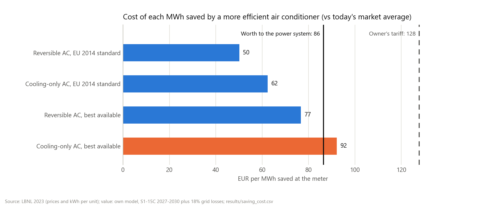

# Phase 7: what saving a MWh costs

**Question:** the model says a saved MWh is worth about 70 EUR to Tunisia's power system, but it treats the saving as free. Saving costs money: a better air conditioner, insulation, LED lamps. Is a real Tunisian measure cheaper than what it avoids?

Code: [`src/tn2030/saving_cost.py`](../../src/tn2030/saving_cost.py), the `saving_cost` rule in the [`Snakefile`](../../Snakefile), tests in [`tests/test_saving_cost.py`](../../tests/test_saving_cost.py). Output: [`results/saving_cost.csv`](../../results/saving_cost.csv).

## The only Tunisian price per kWh saved

I looked for a published cost per kWh saved for any Tunisian measure. Only one study gives the numbers needed:

- **LBNL, *Cost-Benefit Analysis for Air Conditioner in Tunisia* (February 2023).** It prices split air conditioners at five efficiency levels, from today's market to the best available, with the electricity each uses a year in Tunisia. It was written to help ANME set a stricter minimum standard.
- **Others did not give a usable number.** For ANME's [LED programme (PROMO-LED)](http://anme.tn/index.php/fr/project/programme-promo-led) and [roof-insulation programme (PROMO-ISOL)](https://www.anme.tn/fr/project/programme-promo-isol) I found budgets and subsidy rates, but no kWh saved. A [2005 paper on the appliance-label programme](https://www.eceee.org/library/conference_proceedings/eceee_Summer_Studies/2005c/Panel_4/4191lihidheb/) projected a cost below 1 US cent per kWh, but that is a twenty-year-old projection. An estimate of [152 dinars per toe saved (2004-2010)](https://www.citego.org/bdf_fiche-document-2359_en.html) covers industrial programme contracts and all fuels, not electricity.

Air conditioners are also the right place to start: they drive Tunisia's summer peak.

## Method

For each efficient AC, against the average unit sold today:

1. **Extra price:** what the efficient unit costs more to buy (LBNL Tables 11 and 12, US$ of 2021).
2. **kWh saved a year:** the difference in yearly use (same tables; reversible units include winter heating).
3. **Cost per kWh saved:** the extra price spread over the unit's 10.5-year life like a loan, at the model's 7.1% discount rate, divided by the kWh saved each year. This is the same annuity the model uses for power plants. LBNL used 6.3%, which would make every cost about 4% lower.
4. **In EUR:** divided by 1.1827 US$ per EUR, the 2021 average (Bundesbank).

What it is compared with:

- **Worth to the power system:** 70.9 EUR per MWh, the cooling-first saving (S1-15C) over 2027-2030, chosen because an AC standard saves cooling electricity. The model's demand includes grid losses, so a MWh saved at the meter avoids 1 / (1 - 0.18) MWh there: **86 EUR per MWh at the meter**. (18% losses: LBNL Table 16, from STEG 2020.)
- **Worth to the owner:** the top STEG tariff blocks the owner stops paying, 15.1 US cents per kWh: **128 EUR per MWh**.

Every input is a row of the [assumptions register](../../data/assumptions_register.md) (`ac_*`, `grid_losses`, `usd_per_eur_2021`).

## Results

| Measure | Extra price | kWh saved a year | Cost per MWh saved | Worth to the system | Net |
|---|---|---|---|---|---|
| Reversible AC, EU 2014 standard | 51 US$ | 119 | **50 EUR** | 86 EUR | +36 EUR |
| Cooling-only AC, EU 2014 standard | 48 US$ | 90 | **62 EUR** | 86 EUR | +24 EUR |
| Reversible AC, best available | 227 US$ | 346 | **77 EUR** | 86 EUR | +10 EUR |
| Cooling-only AC, best available | 220 US$ | 279 | **92 EUR** | 86 EUR | -6 EUR |

- **The EU standard pays for the power system, with room to spare.** Raising Tunisia's minimum to the EU's 2014 level costs 50-62 EUR per MWh saved, against 86 EUR avoided. Reversible units are 79% of the market, so the cheaper case is also the common one.
- **The best units are close to break-even.** Reversible ones still pay (+10 EUR); cooling-only ones cost slightly more than they avoid (-6 EUR), because they save nothing in winter.
- **Every level pays for the owner.** At 128 EUR per MWh, the owner gains on every unit. This matches LBNL's own result: payback in 2.7 to 5.2 years on a 10-year life.
- **Against the 2030-alone run the margin shrinks.** With no build limit, a cooling-first MWh is worth 62 EUR (76 at the meter). The EU standard still pays; both best-available units then cost about as much as they avoid or more. At Tunisia's real building pace, saving is worth more, so more of it pays.

## How much of the 15% this covers

LBNL estimates that a standard taking effect in 2023 saves **287 GWh in 2030** at the EU level and **841 GWh** at the best available level (both AC types, at the meter). With grid losses, that is **9%** and **25%** of the 4.1 TWh the cooling-first scenario saves in 2030. Air conditioners alone cannot deliver a 15% saving; the rest would need lighting, buildings, industry and pumping, which have no Tunisian price per kWh I could source.

## Limits of this comparison

- **One measure, priced.** Only air conditioners have a sourced Tunisian cost per kWh. The cost of the whole 15% saving is still unknown.
- **Equipment cost only.** LBNL counts the extra purchase price, not the cost of running the standard (testing, enforcement, ANME's administration). These are usually small next to equipment, but they are not zero.
- **Borrowed cost curve.** LBNL scaled a Chinese manufacturing cost curve to Tunisian 2021 retail prices; there is no field survey of how Tunisians use their ACs (use comes from ANME's certification data: 5.5 hours a day for three months).
- **Price years.** LBNL's US$ are of 2021; the model's EUR come from technology-data v0.15.0. The years are not adjusted.
- **Average, not marginal, value.** 86 EUR is the system's average for a 15% cooling-first saving. A single AC standard is smaller, and the first MWh saved can be worth a little more or less than the average.
